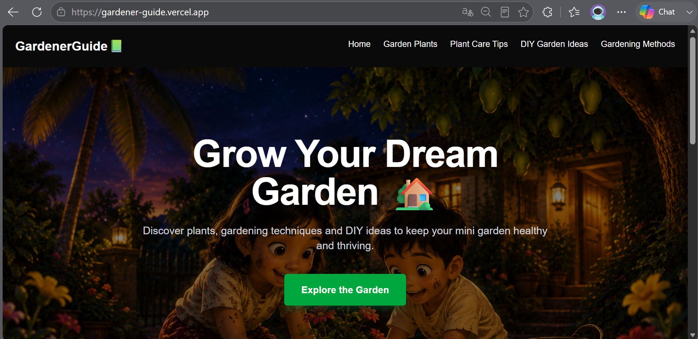
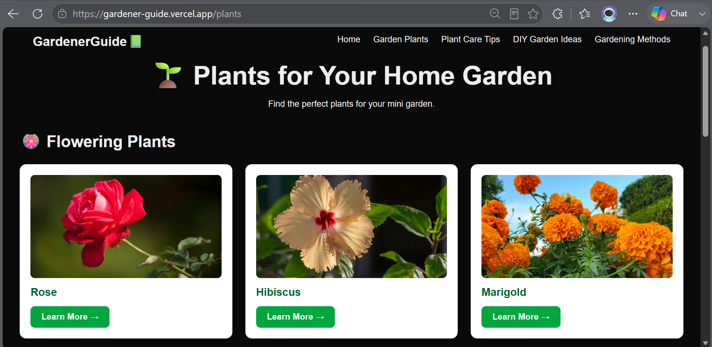
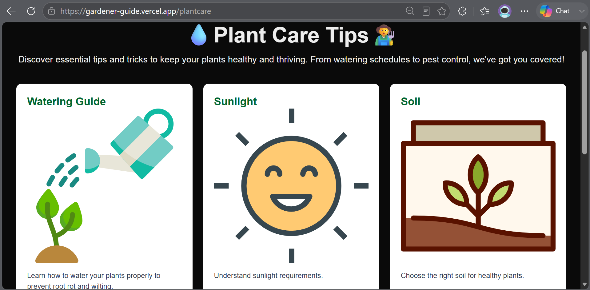
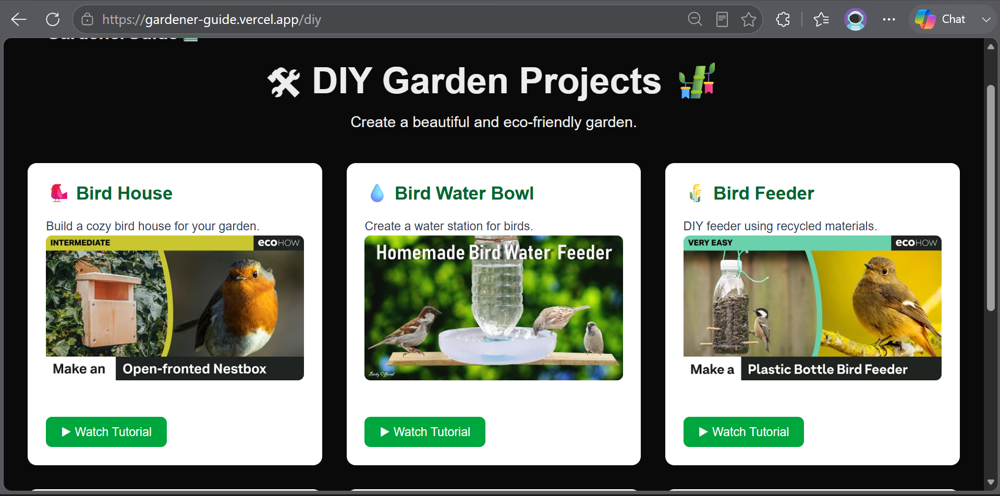
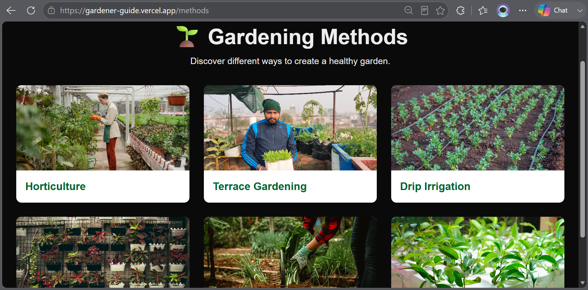

<div align="center">

#  Gardener Guide 📗

### Discover • Learn • Grow

*A modern gardening companion for home gardeners and nature enthusiasts.*

[](https://nextjs.org/)
[](https://react.dev/)
[](https://www.typescriptlang.org/)
[](https://tailwindcss.com/)
[](https://vercel.com/)

### 🌐 Live Website

**https://gardener-guide.vercel.app/**

</div>

---

# 🌱 About the Project

**Gardener Guide** is a modern gardening companion built using **Next.js**, **React**, **TypeScript**, and **Tailwind CSS**.

It is designed to make gardening knowledge simple, accessible, and enjoyable for everyone. Whether you're growing a single Tulasi plant on your balcony or creating a flourishing home garden, Gardener Guide brings together plant guides, care tips, DIY projects, and gardening methods into one easy-to-use platform.

The project combines my passion for technology with my love for nature and aims to encourage more people to enjoy gardening through an interactive web experience.

---

# ✨ Features

## 🌸 Plants for Your Home Garden

Explore different categories of plants including:

- 🌹 Flowering Plants
- 🌿 Medicinal Plants
- 🥬 Kitchen Garden Plants
- 🍋 Fruit Plants

Each plant page includes:

- Beautiful images
- Plant information
- Growing requirements
- Care instructions
- Common problems & solutions
- Recommended YouTube tutorials

---

## 💧 Plant Care Guides

Learn essential gardening skills through dedicated guides covering:

- Watering
- Sunlight
- Soil
- Fertilizers
- Pruning
- Pest Control

Each guide includes:

- Easy-to-understand articles
- Visual illustrations
- Practical gardening tips
- Common mistakes to avoid
- Video tutorials for better understanding

---

## 🛠 DIY Garden Crafts

Discover eco-friendly DIY ideas such as:

- 🐦 Bird Houses
- 💧 Water Bowls for Birds
- 🌾 Bird Feeders
- 🎍 Balcony Decoration Ideas
- 💦 DIY Drip Irrigation
- 🌳 Garden Swings

Every DIY project contains:

- Tutorial thumbnail
- Direct YouTube tutorial
- Simple explanation

---

## 🌱 Gardening Methods

Learn different gardening techniques including:

- Horticulture
- Terrace Gardening
- Drip Irrigation
- Organic Gardening
- Hydroponics
- Vertical Gardening

Each article contains:

- Detailed explanation
- Benefits
- Practical uses
- Related learning videos

---

# 📸 Screenshots


### 🏠 Home Page





### 🌸 Plants Section





### 💧 Plant Care





### 🛠 DIY Garden Crafts





### 🌱 Gardening Methods





---

# 🛠 Tech Stack

<p align="center">


</p>

| Technology | Purpose |
|------------|----------|
| ⚛ React | Component-based UI |
| ▲ Next.js | Routing & Rendering |
| 🔷 TypeScript | Type Safety |
| 🎨 Tailwind CSS | Styling & Responsive Design |
| 🟩 Node.js | Development Runtime |
| 🔀 Git | Version Control |
| 🐙 GitHub | Source Code Hosting |
| ▲ Vercel | Deployment |

---

# 📁 Project Structure

```text
Gardener Guide
│
├── app
│   ├── plants
│   │     ├── rose
│   │     ├── tulasi
│   │     ├── lemon
│   │     └── ...
│   │
│   ├── plantcare
│   │     ├── watering
│   │     ├── sunlight
│   │     ├── soil
│   │     ├── fertilizer
│   │     ├── pruning
│   │     └── pestcontrol
│   │
│   ├── diy
│   │
│   ├── methods
│   │
│   ├── layout.tsx
│   └── page.tsx
│
├── components
│   ├── Navbar
│   ├── Hero
│   ├── Footer
│   ├── PlantCard
│   ├── CareCard
│   ├── DIYCard
│   └── MethodCard
│
├── data
│
├── public
│
└── README.md
```

---

# 🌱 Why I Built This

Gardening has always been a special part of my life.

Growing up surrounded by plants taught me patience, curiosity, and appreciation for nature. I wanted to create something that combines those memories with my journey as a software developer.

**Inspired by a childhood spent in the garden**, Gardener Guide was created to help beginners discover the joy of growing plants while allowing me to strengthen my skills in modern web development.

More than just a coding project, this website represents continuous learning, consistency, and my passion for building meaningful applications.

---

# 📚 What I Learned

While building Gardener Guide, I gained practical experience with:

- Next.js App Router
- React Components
- TypeScript Fundamentals
- Tailwind CSS
- Dynamic Routing
- Responsive Web Design
- Component Reusability
- Data Organization
- Git & GitHub Workflow
- Deploying Applications with Vercel

---

# 🚀 Future Improvements

Some ideas planned for future versions include:

- 🔍 Search plants by name
- 🤖 AI-based Plant Disease Detection
- 📷 Plant Identification using Image Upload
- 🌦 Weather-based Gardening Tips
- 🗓 Seasonal Planting Calendar
- 🌍 More Plant Guides
- 🌼 Additional Gardening Methods
- 🐝 Pollinator Friendly Garden Guide
- 📱 Progressive Web App (PWA)
- ♿ Accessibility Improvements

---

# 🚀 Getting Started

Clone the repository

```bash
git clone https://github.com/SriyaMeenakshi/gardener-guide.git
```

Go into the project

```bash
cd gardener-guide
```

Install dependencies

```bash
npm install
```

Run the development server

```bash
npm run dev
```

Visit

```
http://localhost:3000
```

---

# 🤝 Contributing

Contributions, ideas, and suggestions are always welcome.

If you'd like to improve the project:

1. Fork the repository
2. Create your feature branch

```bash
git checkout -b feature-name
```

3. Commit your changes

```bash
git commit -m "Add new feature"
```

4. Push to GitHub

```bash
git push origin feature-name
```

5. Open a Pull Request

---

# 📄 License

This project is licensed under the **MIT License**.

---

# 👩‍💻 Author

## Sriya Meenakshi Chalamalasetty

**B.Tech CSE (AI & ML)**

Passionate about

🌱 Nature • 💻 Technology • 🎨 Design • 🌍 Open Source

**GitHub**

https://github.com/SriyaMeenakshi

**LinkedIn**

https://www.linkedin.com/in/sriya-meenakshi-chalamalasetty

---

<div align="center">

## 🌿

### *"To plant a garden is to believe in tomorrow."*

**— Audrey Hepburn**

---

### 🌼 Inspired by a childhood spent in the garden.

Every plant tells a story, and every project is a seed that grows with patience, curiosity, and consistency.

**Built with 💚 using Next.js, React, TypeScript, and Tailwind CSS.**

⭐ If you enjoyed this project, consider giving it a star!

</div>